<div align="center">

<a href="https://e-fiuza.github.io/game-feel-ui/">
  
</a>

<br />

<p align="center">
  <a href="https://e-fiuza.github.io/game-feel-ui/"><strong>▶ Demos Interativas ao Vivo</strong></a>
  &nbsp;·&nbsp;
  <a href="https://e-fiuza.github.io/game-feel-ui/install.html"><strong>📖 Tutorial de Instalação e Uso</strong></a>
  &nbsp;·&nbsp;
  <a href="#instalação"><strong>Instalação Rápida</strong></a>
  &nbsp;·&nbsp;
  <a href="#três-fluxos-de-uso"><strong>Três Fluxos de Uso</strong></a>
  &nbsp;·&nbsp;
  <a href="#da-game-engine-para-o-dom"><strong>39 Mecânicas</strong></a>
  &nbsp;·&nbsp;
  <a href="./README.md"><strong>English</strong></a>
</p>

<p align="center">
  <a href="https://e-fiuza.github.io/game-feel-ui/"></a>
  <a href="https://github.com/e-fiuza/game-feel-ui/actions/workflows/ci.yml"></a>
  <a href="./LICENSE"></a>
  
  
</p>

</div>

---

**Frontends gerados por IA até funcionam, mas quase sempre parecem "sem vida" — páginas estáticas, cliques secos em `0ms` ou escondidos atrás de um genérico `transition: all 0.3s ease`.**

A **`game-feel-ui`** é uma skill open-source para **Claude Code**, **Cursor**, **Codex**, **Windsurf** e **Gemini CLI** especializada em detectar pontos "sem graça" da sua interface e deixar seu frontend mais **dinâmico, fluido, tátil e atraente** — usando truques sutis comprovados no desenvolvimento de jogos.

Estúdios de jogos passam meses calibrando os primeiros **50ms a 120ms** de cada interação — aplicando princípios cunhados por Steve Swink (*Game Feel*) e Martin Jonasson & Petri Purho (*Juice it or lose it*) para que objetos virtuais transmitam peso, tensão e fluidez real. Esta skill traduz **39 mecânicas determinísticas** (*Squash & Stretch, Hitstop, Spring Overshoot*), **tolerância invisível de UX** (*Coyote Time em menus, Hold-to-Commit*) e **síntese sonora Web Audio API de 0 KB** para **11 stacks de web e mobile** sem transformar softwares sérios em gamificação exagerada.

> [!TIP]
> **Quer sentir a diferença antes de ler?** Abra o **[Showcase Interativo ao Vivo ↗](https://e-fiuza.github.io/game-feel-ui/)** para testar a **Comparação em Câmera Lenta (`0.25x`)**, interagir com **12 demonstrações lado a lado (Standard UI vs. Game Feel UI)** e ouvir o **sintetizador Web Audio de 0 KB** direto no navegador.

---

## Instalação

```bash
npx skills add e-fiuza/game-feel-ui
```

> 📖 **Quer um passo a passo detalhado ou prompts prontos para copiar?** Acesse o **[Tutorial Interativo de Instalação e Uso ↗](https://e-fiuza.github.io/game-feel-ui/install.html)**.

<details>
<summary><strong>Claude Code Plugin Marketplace</strong></summary>

Dentro de uma sessão do Claude Code:

```text
/plugin marketplace add e-fiuza/game-feel-ui
/plugin install game-feel-ui
```
</details>

<details>
<summary><strong>Clone Manual (Local por Projeto ou Global)</strong></summary>

```bash
# Escopo de um projeto
git clone https://github.com/e-fiuza/game-feel-ui.git .claude/skills/game-feel-ui

# Escopo global (todos os repositórios)
git clone https://github.com/e-fiuza/game-feel-ui.git ~/.claude/skills/game-feel-ui
```
</details>

---

## Três Fluxos de Uso

Descreva o resultado desejado em linguagem natural, ou acione um fluxo determinístico específico:

| Modo | O que você digita no agente | O que você recebe no código |
| :--- | :--- | :--- |
| **`01 · Component Polish`**<br />*Componente ou tela* | `"Deixe nosso dashboard mais dinâmico, fluido e atraente melhorando nossos botões, toggles e menus dropdown com a game-feel-ui."` | Consulta 39 mecânicas e 11 stacks entregando física de mola a 60fps (`transform`/`opacity`), pré-carga tátil no clique, 160ms de perdão no hover (Coyote Time) e fallback para `prefers-reduced-motion`. |
| **`02 · Codebase Audit`**<br />*Scanner estático de código* | `"Faça uma auditoria no nosso dashboard com a game-feel-ui e corrija as 3 principais interações mortas."` | Executa `scripts/search.py --audit`, calcula o **Juice Score (0–100)**, aponta cliques secos, modais `window.confirm()` e animações pesadas por `arquivo:linha` e aplica as correções. |
| **`03 · System Blueprint`**<br />*Tokens CSS calibrados* | `"Gere um blueprint de Game Feel para B2B SaaS com juice 5, forgiveness 8, audio 3 e salve no projeto."` | Executa `scripts/search.py --blueprint --persist`, calibra as Custom Properties (`--gf-press-scale`, `--gf-hitstop-ms`, `--gf-coyote-grace-ms`) e grava o contrato em `game-feel-system/MASTER.md`. |

---

## Da Game Engine para o DOM

| Mecânica de Game Dev | O que faz nos Jogos | Tradução para Web & Mobile UI |
| :--- | :--- | :--- |
| **Anticipation (`M01`)** | Personagem flexiona o corpo ou carrega a varinha antes do disparo. | **Pré-carga Tátil (`scale(0.94)`)** no `pointerdown` armazenando energia elástica antes do `pointerup`. |
| **Hitstop / Freeze Frames (`M04`)** | Congela a tela por 3–5 frames no impacto da espada para transmitir peso. | **Micro-Pausa Pré-Recompensa (60–85ms)** no pico da compressão antes de expandir para o estado de sucesso. |
| **Squash & Stretch (`M08/M09`)** | Projétil estica em alta velocidade e achata no impacto. | **Spring Overshoot & Thumb Morph**: o pino do toggle estica `scaleX(1.25)` durante o trajeto e assenta com mola. |
| **Coyote Time (`M15–M19`)** | Permite pular até 120ms após sair da borda da plataforma. | **Perdão Invisível**: 160ms de tolerância em menus dropdown, área de clique expandida e janela de Undo de 4s. |
| **Hold-to-Commit (`M21`)** | Carregar um ataque forte com subida de tom e tremor. | **Ações Destrutivas sem Modal**: segurar "Revogar" preenche uma barra de tensão com reversão suave ao soltar. |
| **Pitch Escalation (`M20`)** | Coletar moedas em sequência sobe a nota musical a cada moeda. | **Combo em Checklists e Kanban**: conclusões seguidas sobem `+2 semitons` (`440 * 2^(n/12)`) via Web Audio API. |
| **Damped Recoil (`M11`)** | Atirador recua; alvo treme ao ser atingido. | **Error Shake Amortecido (`±6px → 0px`)** em inputs inválidos acompanhado de grave `140Hz→52Hz`. |

---

## Os 3 Dials de Calibração (Frequência vs. Intensidade)

Uma tabela densa de B2B SaaS nunca deve animar como um caça-níquel. A `game-feel-ui` controla a sutileza através de três eixos independentes:

- **`--juice` (`1–10`)**: Cinemática visual (`--gf-press-scale`, `--gf-overshoot-scale`, `--gf-spring-stiffness`, `--gf-hitstop-ms`).
- **`--forgiveness` (`1–10`)**: Ergonomia invisível (`--gf-coyote-grace-ms`, `--gf-hit-slop-px`, `--gf-undo-window-ms`). Recomendado entre **`7–9`** para todas as aplicações produtivas.
- **`--audio` (`0–10`)**: Ganho máximo do sintetizador Web Audio API (`--gf-audio-max-gain`) e intensidade de vibração háptica.

---

## Catálogo e Cobertura de Stacks

| Dataset | Itens | Escopo |
| :--- | :---: | :--- |
| [`data/mechanics.csv`](./data/mechanics.csv) | **39** | *Anticipation*, *Impact & Hitstop*, *Spring & Morph*, *Coyote Forgiveness*, *Spatial 3D*, *Progression & Audio* |
| [`data/components.csv`](./data/components.csv) | **23** | Receitas por componente em **L1 Subtle**, **L2 Balanced** e **L3 Juicy** |
| [`data/audio-haptics.csv`](./data/audio-haptics.csv) | **11** | Receitas procedurais via Web Audio API (0 KB de assets) + padrões `navigator.vibrate` |
| [`data/physics-curves.csv`](./data/physics-curves.csv) | **7** | Presets de `linear()`, `cubic-bezier` e parâmetros de mola (stiffness/damping/mass) |
| [`data/app-profiles.csv`](./data/app-profiles.csv) | **8** | Perfis verticais (*B2B SaaS, Fintech, EdTech, DevTools, E-Commerce, AI Workspace, Consumer, Creative*) |
| [`data/anti-patterns.csv`](./data/anti-patterns.csv) | **8** | Guardrails de performance a 60fps, prevenção de fadiga sonora e `prefers-reduced-motion` |
| [`data/stacks/*.csv`](./data/stacks/) | **11** | `react`, `nextjs`, `framer-motion`, `html-tailwind`, `css-waapi`, `gsap`, `shadcn`, `vue`, `svelte`, `react-native`, `flutter` |

---

## Validação e Testes

Zero dependências externas (usa apenas a biblioteca padrão do Python 3.8+):

```bash
python scripts/validate_data.py
python scripts/tests/test_game_feel.py
```

---

## Licença

MIT © [Eduardo Fiuza](https://github.com/e-fiuza)
